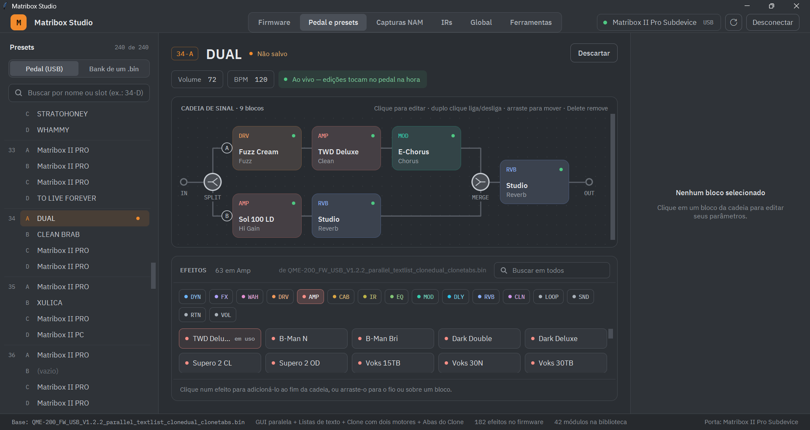

# Getting started: your first custom firmware

*[Versão em português](getting-started.pt-br.md)*

This guide takes you from a stock Matribox II Pro to a custom firmware with:

- **dual chains**: two parallel effect paths in one preset, drawn on the pedal's screen as two rows;
- **text lists**: knobs that show names ("Tremolo", "Vibrato"…) instead of numbers;
- **NAM captures**: real [Neural Amp Modeler](https://www.tone3000.com) captures playing in the Clone menu;
- **new effects**: the example effects of this project, and optionally effects ported from the Valeton
  GP-200 and the Matribox II (QME-100).

You do not need to program or install anything besides the Studio. The Studio's screens are in Portuguese; this
guide quotes their labels as they appear, with a translation where it helps.

> **Before you start.** Flashing a custom firmware is at your own risk, but it is reversible: you can always
> go back to the official firmware with the same steps (see [Going back](#going-back-to-the-official-firmware)).
> **Every firmware update replaces the pedal's presets** with the ones inside the file, so if you have presets
> you care about, save them first (with the official editor, or write their settings down). Your NAM captures
> and User IRs are kept.

## What you need

- A Matribox II Pro and its USB cable.
- A Windows PC.
- The official firmware file **`QME-200_FW_USB_V1.2.2.bin`**, from Sonicake's website (the download page of
  the Matribox II Pro). Version V1.2.2 matters: the tools are made for it.
- For NAM: one or more **A2** captures (`.nam` files). See [step 6](#step-6-load-nam-captures).

## Step 1: install the Studio

1. Download `MatriboxStudio-windows.zip` from the
   [Releases page](https://github.com/zxmarcos/matribox-studio/releases).
2. Unzip it into a folder of your choice (for example `Documents\MatriboxStudio`). Do not run it from inside
   the zip.
3. Copy `QME-200_FW_USB_V1.2.2.bin` into the **`firmware`** folder that is next to `MatriboxStudio.exe`.
4. Run **`MatriboxStudio.exe`**. Windows may warn that the app is from an unknown publisher: choose
   "More info" and "Run anyway".

The Studio opens on the **Firmware** tab, with the official firmware as the starting point ("Base", in the
bottom bar).

## Step 2: make a base with the new features

The features that change how the pedal works (dual chains, text lists, NAM in the Clone menu) are patches to the
pedal's program. The Studio applies them to the official firmware and saves the result as a new **base**.

1. On the Firmware tab, click the **⋯** button at the top right and choose **"Gerar base do original…"**
   (make a base from the original).
2. "Firmware original" already points to your `.bin`. Under **"PATCHES DO APP"**, turn on:
   - **"GUI paralela"**: dual chains drawn as two rows;
   - **"Listas de texto"**: knobs with named options;
   - **"Clone com dois motores"**: each Clone slot plays either a factory capture or a NAM capture;
   - **"Abas do Clone"**: the Clone menu gets "Native" and "NAM A2" tabs, to find each kind quickly.
3. Leave **"Adicionar Split / Path B / Merge"** on (the dual chain needs these three blocks; the Studio turns
   it on for you).
4. Click **"Gerar base"**. After a few seconds you see "Base gerada". Click **"Usar como base"**.

The bottom bar now shows the new base, for example `QME-200_FW_USB_V1.2.2_parallel_textlist_clonedual_clonetabs.bin`.
You only need to do this once.

## Step 3 (optional): extract effects from other pedals

The Valeton GP-200 and the Matribox II (QME-100) run on the same platform and have effects the Pro does not
(drives, amps, delays and reverbs such as Bad-KT, Silver Twin, Ice Delay and Tube Spring). You can bring them
over from their official firmware files.

1. Download the official firmware of the other pedal from its maker: `GP-200_USB_Firmware_V1.8.2.bin` and/or
   `QME-100_FW_USB_V1.3.0.bin`.
2. Open the **Ferramentas** (tools) tab and pick the pedal on the left. Do the GP-200 first if you want both.
3. Choose the file under **"FIRMWARE ORIGINAL"**. A green line means it is the exact file the recipe was made
   for.
4. Click **"Extrair efeitos"** (extract effects) and wait about a minute and a half. The table fills in as each
   effect is converted.

The extracted effects are added to the Studio's libraries and show up in the Firmware tab, under the origin
"Valeton GP-200" or "Matribox II (QME-100)".

## Step 4: choose the effects

Back on the **Firmware** tab, the list shows every effect: the ones already in the base (origin "Fábrica",
factory) and the ones from the libraries (Tutorial, Próprios, Roteamento, and the ported pedals).

- **Tick** an effect to put it in the firmware; **untick** it to leave it out. Library effects start unticked.
- Tick at least **Multi Mode** (origin "Próprios"): it is the effect that shows the text lists working. Mod
  Echo and Gain Boost are other examples.
- Use the **menus on the left** and the **search box** to find effects; "Alterações" (changes) lists only what
  you changed.

The bar at the bottom ("BIBLIOTECA DSP") shows how full the pedal's effect memory is: 2.5 MB in total, most of it
taken by the factory effects. If part of it turns red, the selection does not fit: untick some effects, for
example factory effects you never use (the Studio warns if a factory preset uses one). The status on the right says **"Tudo certo"** (all good) when
the selection can be built.

**"Salvar perfil"** (save profile) keeps your selection in a file, to reopen it later with "Abrir perfil…" in
the ⋯ menu. The Studio also remembers it when you close it.

## Step 5: build and send the firmware

1. Click **"Gerar firmware"** (build firmware, or Ctrl+G).
2. Under **"MOTOR DO CLONE"** (Clone engine) choose **"Fábrica + NAM A2 (automático por slot)"**: each Clone
   slot then plays whatever capture it holds, factory or NAM.
3. If you use the official PC editor, turn on **"Gerar também a lista do editor de PC"**: it writes an
   `alg_data.json` next to the `.bin`, with the new effect list for the editor (copy it to
   `data\flutter_assets\assets\alg\` of a copy of the editor). If you only use the Studio and the pedal, skip
   it.
4. Click **"Gerar firmware"**. When "Firmware gerado" appears, click **"Enviar ao pedal"** (send to pedal).
5. **Close the official PC editor** if it is open (only one program can talk to the pedal at a time), connect
   the pedal by USB and turn it on.
6. In the "Atualizar o pedal" window, click **"Atualizar pedal"** and confirm. The pedal restarts in update
   mode and the firmware is written. **Do not unplug or turn off the pedal** until it says "Firmware gravado".
   It then restarts with the new firmware.

If something fails, the pedal stays in update mode and you can click "Tentar de novo" (try again).

## Step 6: load NAM captures

The pedal runs NAM captures of the **A2** architecture (NAM 0.7 and later; on [TONE3000](https://www.tone3000.com)
look for A2 captures). The older "standard" captures do not run on the pedal.

1. Open the **Capturas NAM** tab and click **"Conectar"** at the top right if the pedal is not connected yet.
2. Click **"Pasta"** and choose the folder with your `.nam` files. The list says which captures run on the
   pedal.
3. On the left, pick a **Clone slot** (1 to 10). On the list, pick a capture.
4. On the right, give it a name and click **"Gravar no Clone N"** (write to Clone N). The Studio warns before
   replacing a slot.

On the pedal, add a **Clone** block (menu CLN) to a preset and choose the slot: the **"NAM A2"** tab lists the
slots with NAM captures, **"Native"** the factory ones. A 48 kHz capture is resampled on the fly, so it sounds
as it should.

## Step 7: use the new features

### Dual chains



A dual chain is built from three blocks of the **EQ** menu, "Routing" tab:

```
IN -> [Split] -> path A effects -> [Path B] -> path B effects -> [Merge] -> OUT
```

1. Open the **Pedal e presets** tab, click **"Conectar"** and pick a preset on the left. Edits play on the pedal
   right away.
2. Under **"EFEITOS"**, click **EQ** and add **Split**, then the effects of path A, then **Path B**, then the
   effects of path B, then **Merge**. Click an effect to add it at the end of the chain, or drag it onto the
   chain where you want it. Drag blocks to reorder them; Delete removes the selected block.
3. The chain is drawn in two rows, on the Studio and on the pedal's screen.
4. Click **Merge** to set the mix: Level A / Level B, Pan A / Pan B, and Phase B. Split's Mode picks which input
   goes to the paths (Mono L, Mono R or Stereo).
5. Save the preset with the pedal's own **SAVE** button. "Descartar" (discard) in the Studio undoes your edits.

Typical uses: two amps at once, a dry path next to a heavily effected one, parallel compression.

One dual section per preset. The three routing blocks take 3 of the 12 slots of a preset.

### Text lists

Add **Multi Mode** (menu MOD, tab "Special") to a preset. Its Mode knob shows **Tremolo, Vibrato, Ring Mod,
Bitcrush, Octave Fuzz** on the pedal and in the Studio, instead of 0 to 4. Any effect whose manifest has named
options shows them the same way.

## Going back to the official firmware

Click **"Atualizar pedal"** at the top of the Firmware tab, choose the official `QME-200_FW_USB_V1.2.2.bin` and
click "Atualizar pedal". Everything is back to factory (presets included); NAM captures and User IRs stay in
their slots.

If the pedal ever fails to start, it can still be updated: hold the footswitch combination that Sonicake's
instructions give for update mode while turning it on, then flash the official file the same way. Normal
updates never touch the part of the pedal that does this, so it is always available.

## Where to go next

- [Write your own effect in C](effects/tutorial.md).
- [How the patches work](app-patches.md), [NAM on the pedal](nam.md), [the ports](ports.md).
- [The Studio and the command-line tools](tools.md).
